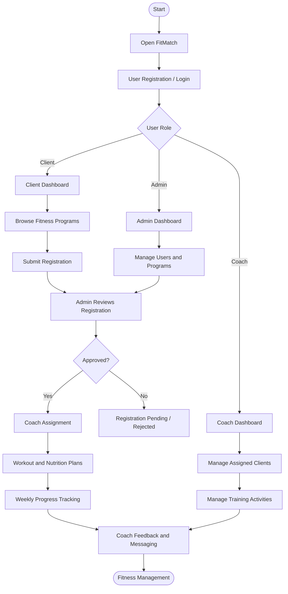
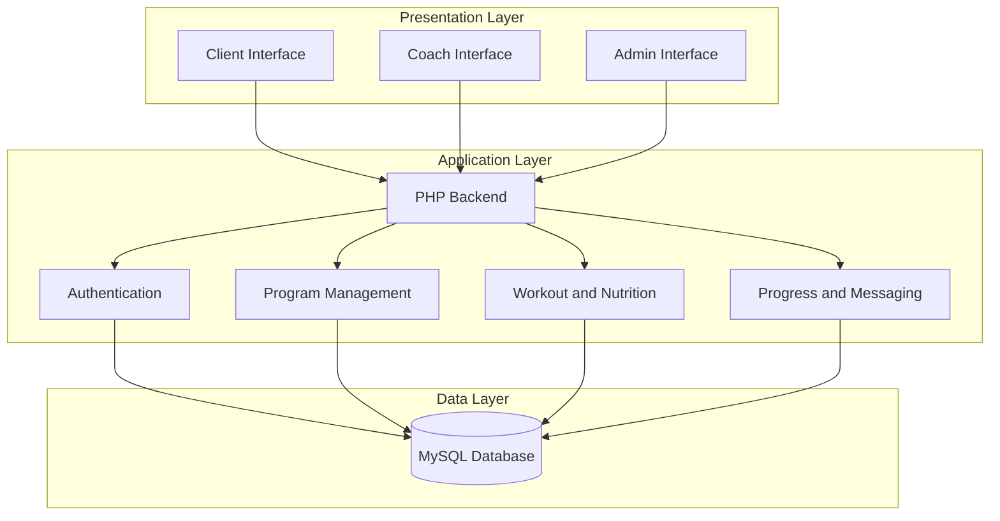
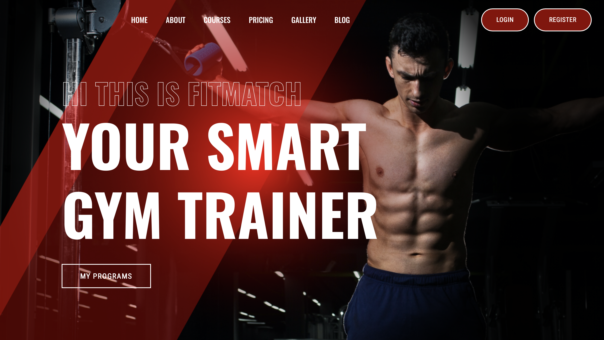
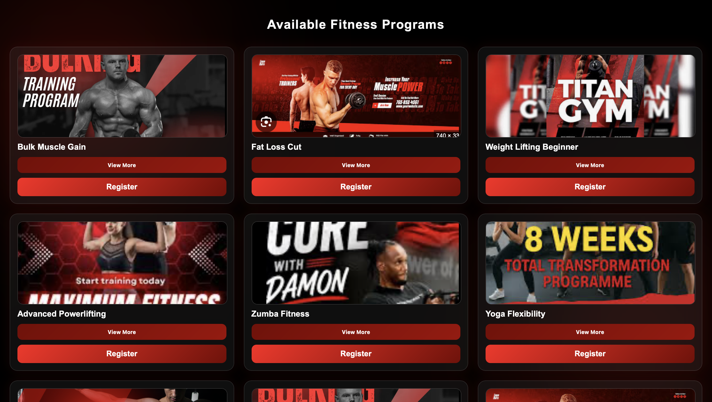
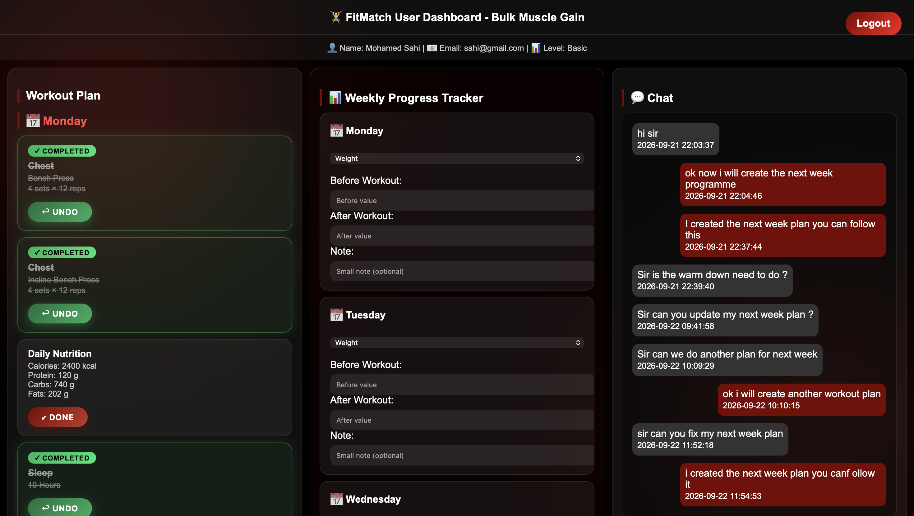
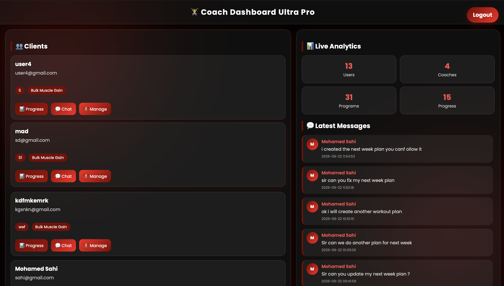
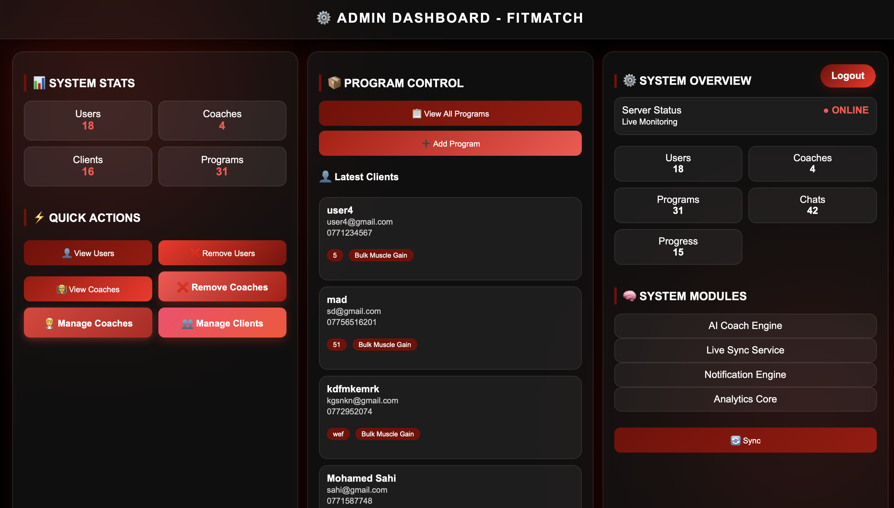
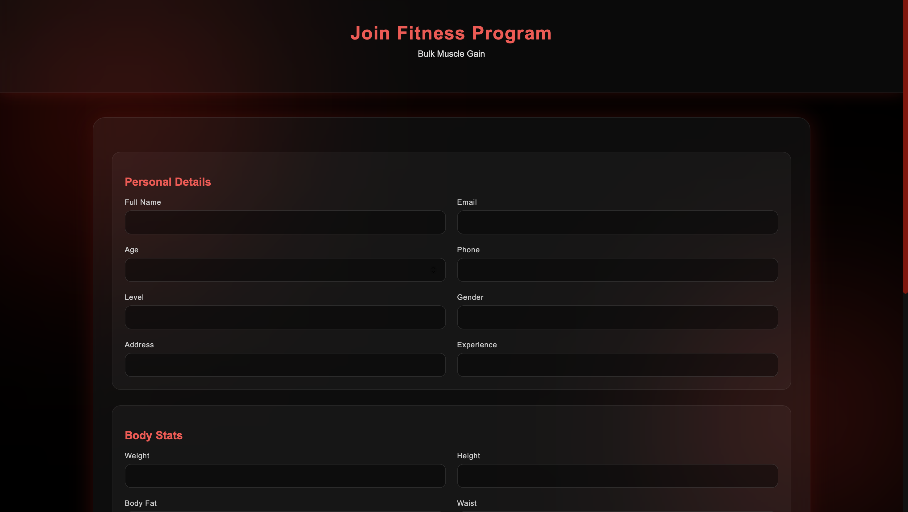
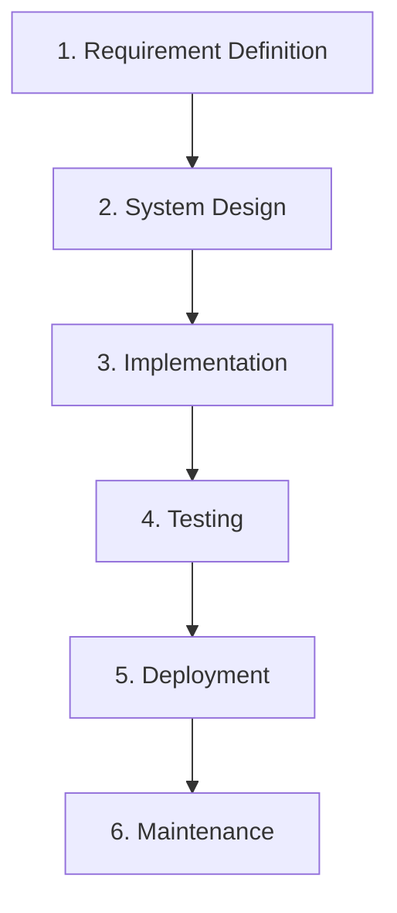

<div align="center">

# 💪 FitMatch

### AI-Based Fitness Management System

**A Smarter Way to Manage Your Fitness Journey**

A centralized web-based platform connecting fitness enthusiasts, professional coaches, and administrators through an integrated fitness management experience.

<br>


<br>

**Developed by Group CST24**

**Uva Wellassa University of Sri Lanka | 2026**

</div>

---

# 📌 Table of Contents

1. [Project Overview](#-project-overview)
2. [Problem Statement](#-problem-statement)
3. [Aim and Objectives](#-aim-and-objectives)
4. [Key Features](#-key-features)
5. [User Roles and Permissions](#-user-roles-and-permissions)
6. [How the System Works](#-how-the-system-works)
7. [System Architecture](#-system-architecture)
8. [Technology Stack](#-technology-stack)
9. [Database Management](#-database-management)
10. [Security](#-security)
11. [Project Structure](#-project-structure)
12. [Installation and Setup](#-installation-and-setup)
13. [Expected Outcomes](#-expected-outcomes)
14. [Screenshots](#-screenshots)
15. [Future Enhancements](#-future-enhancements)
16. [Development Methodology](#-development-methodology)
17. [Development Team](#-development-team)
18. [Copyright and License](#-copyright-and-license)

---

# 🚀 Project Overview

**FitMatch – AI-Based Fitness Management System** is a web-based fitness management platform designed to modernize fitness center operations and improve the overall fitness management experience.

The system provides a centralized environment where clients can explore fitness programs, register online, access workout plans, receive nutrition guidance, monitor fitness progress, and communicate with professional coaches.

FitMatch also provides dedicated dashboards for coaches and administrators, allowing them to manage clients, fitness programs, training activities, and registration processes efficiently.

The platform aims to reduce manual fitness center management activities and provide a more organized, accessible, and technology-driven fitness environment.

### 💡 Our Vision

To create a smarter and more connected fitness ecosystem where clients, coaches, and fitness administrators can manage fitness activities through one integrated digital platform.

---

# ❗ Problem Statement

Traditional fitness centers may depend on manual registration processes, paper-based records, and separate communication methods.

These approaches can create several challenges:

- Time-consuming manual registration.
- Difficulties managing clients and coaches.
- Limited access to personalized fitness information.
- Lack of centralized progress monitoring.
- Inefficient communication between coaches and clients.
- Difficulty organizing fitness programs and registrations.

### ✅ Proposed Solution

FitMatch addresses these challenges through a centralized web application that integrates fitness program registration, client management, workout planning, nutrition guidance, progress tracking, and communication.

---

# 🎯 Aim and Objectives

### Main Aim

To develop a secure and user-friendly web-based fitness management system that connects clients, coaches, and administrators while improving fitness program management, progress monitoring, and communication.

### Specific Objectives

1. Develop a user registration and authentication system.
2. Provide online fitness program browsing and registration.
3. Implement coach and client management functionality.
4. Provide personalized workout and nutrition plan management.
5. Develop a weekly fitness progress tracking system.
6. Enable communication between coaches and clients.
7. Provide an administrative dashboard for centralized management.
8. Improve the accessibility and efficiency of fitness management activities.

---

# ✨ Key Features

| Feature | Description |
|---|---|
| User Authentication | User registration, login, and session management |
| Fitness Programs | Browse and explore available fitness programs |
| Online Registration | Submit fitness program registration details |
| Client Dashboard | Access personalized fitness information |
| Coach Dashboard | Manage assigned clients and training activities |
| Admin Dashboard | Manage users, coaches, programs, and registrations |
| Workout Management | Manage workout plans and training activities |
| Nutrition Management | View nutrition plans and dietary information |
| Progress Tracking | Record and monitor weekly fitness progress |
| Messaging System | Communication between coaches and clients |
| Fitness Recommendations | Support personalized fitness program suggestions |

---

# 👥 User Roles and Permissions

FitMatch consists of three primary user roles.

| Functionality | Client | Coach | Administrator |
|---|:---:|:---:|:---:|
| Register and Login | ✅ | ✅ | ✅ |
| Browse Fitness Programs | ✅ | According to access | ✅ |
| Register for Programs | ✅ | According to access | — |
| Manage Clients | — | ✅ | ✅ |
| Manage Fitness Programs | — | According to permissions | ✅ |
| Manage Workout Plans | View | ✅ | — |
| Manage Nutrition Plans | View | According to permissions | — |
| Submit Fitness Progress | ✅ | — | — |
| Monitor Client Progress | — | ✅ | — |
| Coach–Client Messaging | ✅ | ✅ | — |
| Approve Registrations | — | — | ✅ |
| Manage System Users | — | — | ✅ |

*Access to individual functions depends on the assigned role and system permissions.*

## 👤 Client Dashboard

Clients can:

- Create an account and log in.
- Browse fitness programs.
- Submit online registration forms.
- View their assigned fitness information.
- Access workout plans.
- View nutrition plans.
- Record weekly fitness progress.
- Communicate with assigned coaches.

## 🏋️ Coach Dashboard

Coaches can:

- Access their coach dashboard.
- View assigned fitness programs.
- Manage registered clients.
- Provide workout guidance.
- Manage client training activities.
- Monitor client progress.
- Communicate with clients.

## 🛠️ Administrator Dashboard

Administrators can:

- Manage user accounts.
- Manage coaches.
- Manage fitness programs.
- Review client registrations.
- Approve registration requests.
- Monitor system activities.
- Oversee overall platform operations.

---

# 🔄 How the System Works

The following diagram represents the main FitMatch workflow.



---

# 🏗️ System Architecture

FitMatch follows a three-layer web application architecture.



### Architecture Explanation

| Layer | Technology | Responsibility |
|---|---|---|
| Presentation | HTML, CSS, JavaScript, Bootstrap | User interface and interaction |
| Application | PHP | Backend processing and business logic |
| Database | MySQL | Data storage and management |
| Web Server | Apache | Application hosting and PHP execution |

---

# 💻 Technology Stack

### Frontend Technologies

| Technology | Purpose |
|---|---|
| HTML5 | Web page structure |
| CSS3 | Styling and visual design |
| JavaScript | Interactive functionality |
| Bootstrap | Responsive interface components |

### Backend Technologies

| Technology | Purpose |
|---|---|
| PHP | Server-side application development |
| MySQL | Relational database management |
| Apache | Web server |

### Development Tools

| Tool | Purpose |
|---|---|
| Visual Studio Code | Code development |
| XAMPP | Local development environment |
| Git | Version control |
| GitHub | Repository hosting |
| Draw.io | System diagrams and database design |

---

# 🗄️ Database Management

FitMatch uses a relational MySQL database named `fitmatch`.

The database contains multiple interconnected tables to manage users, programs, registrations, workout information, nutrition plans, progress records, and communication.

### Main Database Tables

| Table | Purpose |
|---|---|
| users | User accounts and roles |
| user_profile | User profile information |
| programs | Fitness program information |
| registrations | Client registration records |
| registration_details | Additional registration information |
| coach_programs | Coach-program relationships |
| workout_plan | Workout plans |
| workouts | Workout activities |
| workout_sets | Workout set records |
| workout_progress | Workout performance records |
| nutrition_plan | Nutrition information |
| progress | Client progress records |
| chat_messages | Communication messages |
| coach_comments | Coach feedback |

**Database availability:** The SQL database export is not included in this public repository. A separate compatible SQL export is required to recreate the database.

---

# 🔐 Security

Security is an important consideration in FitMatch.

Security-related mechanisms and development practices include:

- User authentication.
- Session-based authentication.
- Role-based access control.
- Server-side input validation.
- Database query protection through prepared statements where implemented.
- Restricted access to role-specific dashboard functionality.
- Separation of private database configuration from public source code.

### Security Recommendations

Before deploying FitMatch to a public hosting environment:

- Use secure password hashing with PHP password functions.
- Enable HTTPS.
- Implement CSRF protection.
- Validate and sanitize user input.
- Configure secure session cookies.
- Use restricted database accounts instead of unrestricted root access.
- Protect configuration files and sensitive information.
- Review authorization checks on every protected backend action.

---

# 📁 Project Structure

```text
FitMatch-AI-Based-Fitness-Management-System/
│
├── frontend/
│   ├── HTML Pages
│   ├── CSS Files
│   ├── JavaScript Files
│   └── Frontend Resources
│
├── images/
│   └── Application Images
│
├── Php/
│   ├── Authentication
│   ├── Registration
│   ├── Database Operations
│   ├── Client Dashboard
│   ├── Coach Dashboard
│   ├── Admin Dashboard
│   └── Other Backend Modules
│
├── index.php
│
└── README.md
```

*The structure above is a simplified overview of the repository.*

---

# ⚙️ Installation and Setup

Follow the instructions below to run FitMatch on your local machine.

## Prerequisites

Install the following:

- [XAMPP](https://www.apachefriends.org/)
- [Visual Studio Code](https://code.visualstudio.com/)
- [Git](https://git-scm.com/)
- Google Chrome or another modern browser

## Step 1: Clone the Repository

Open Terminal and execute:

```bash
git clone https://github.com/gayathpathirana/FitMatch-AI-Based-Fitness-Management-System.git
```

## Step 2: Move into the Project Directory

```bash
cd FitMatch-AI-Based-Fitness-Management-System
```

## Step 3: Configure XAMPP

Copy the project folder into the XAMPP `htdocs` directory.

**macOS:**

```text
/Applications/XAMPP/xamppfiles/htdocs/
```

**Windows:**

```text
C:\xampp\htdocs\
```

## Step 4: Start the Servers

Open XAMPP and start:

- Apache
- MySQL

## Step 5: Create the Database

Open phpMyAdmin:

```text
http://localhost/phpmyadmin
```

Create a database named:

```sql
CREATE DATABASE fitmatch;
```

Obtain the compatible FitMatch SQL database export separately and import it into the database.

**Important:** The SQL export is not included in this repository. Database-dependent functionality requires the correct database structure and data.

## Step 6: Configure Database Connection

Open:

```text
Php/db.php
```

Configure your local database credentials.

Example:

```php
<?php

$host = "127.0.0.1";
$username = "root";
$password = "YOUR_MYSQL_PASSWORD";
$database = "fitmatch";

$conn = new mysqli(
    $host,
    $username,
    $password,
    $database
);

if ($conn->connect_error) {
    die("Database connection failed: " . $conn->connect_error);
}

$conn->set_charset("utf8mb4");

?>
```

Never publish your real database password in a public repository.

## Step 7: Open FitMatch

Open your browser:

```text
http://localhost/FitMatch-AI-Based-Fitness-Management-System/
```

If your local folder has a different name, use that folder name in the URL.

---

# 📊 Expected Outcomes

FitMatch aims to provide:

| Area | Expected Outcome |
|---|---|
| Registration | Simplified online program registration |
| Management | Centralized user and program management |
| Coaching | Better coach-client coordination |
| Workout | Organized workout plan management |
| Nutrition | Accessible nutrition guidance |
| Progress | Improved fitness progress monitoring |
| Communication | Integrated messaging |
| Administration | More efficient administrative operations |

---

# 📸 Application Screenshots

The following section can showcase the actual FitMatch application.

**Add your own screenshots to the repository and update the image paths below.**

### Home Page


### Fitness Programs


### Client Dashboard


### Coach Dashboard


### Admin Dashboard


### Registration Page


---

# 🔮 Future Enhancements

The following improvements are considered for future development:

- Advanced AI-based fitness recommendations.
- Online payment gateway integration.
- Mobile application development.
- Advanced fitness analytics and reporting.
- Attendance tracking.
- Improved workout performance visualization.
- Email notifications and reminders.
- Enhanced mobile responsiveness.
- Additional security improvements.

---

# 🔬 Development Methodology

FitMatch follows the **Waterfall Software Development Methodology**.

The development process consists of six phases:



Each phase provides a structured foundation for the next development stage.

---

# 👨‍💻 Development Team

**Group CST24**

Computer Science and Technology  
Department of Computer Science and Informatics  
Faculty of Applied Sciences  
Uva Wellassa University of Sri Lanka

| Team Member | Responsibility |
|---|---|
| K.P.G.D. Pathirana | Main Developer / Full Stack Lead |
| I.R. Ahamed | Database & Backend Support Developer |
| M.N.M. Zakee | Frontend Support Developer |

### Project Information

| Item | Details |
|---|---|
| Project Name | FitMatch – Fitness Management System |
| Module | CST292-2 |
| Group | CST24 |
| Institution | Uva Wellassa University of Sri Lanka |
| Academic Year | 2026 |
| Project Type | Web-Based Application |

---

# 📜 Copyright and License

**Copyright © 2026 Group CST24. All Rights Reserved.**

FitMatch – AI-Based Fitness Management System is an academic group project developed by students of the Computer Science and Technology degree programme at Uva Wellassa University of Sri Lanka.

The source code, project documentation, design materials, and other original project assets are provided for academic and portfolio demonstration purposes.

No part of this project may be copied, redistributed, modified, or used for commercial purposes without appropriate permission from the respective project contributors.

Third-party libraries, frameworks, and technologies remain the property of their respective owners and are subject to their own licenses.

For permission or project-related inquiries, please contact the project contributors.

---

<div align="center">

### 💪 FitMatch

**Connecting Fitness. Empowering People. Building Healthier Futures.**

Developed with dedication by **Group CST24**

⭐ Thank you for visiting our repository!

</div>
